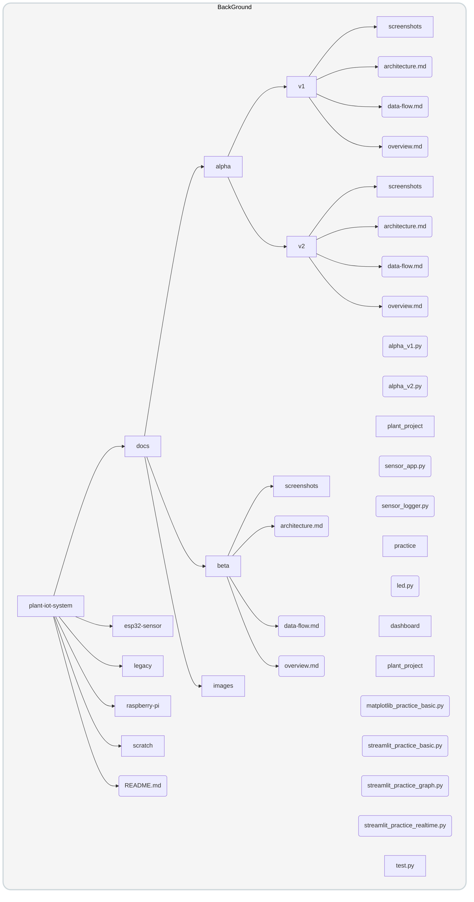

# 🪴植物環境可視化システム（ObserLeaf）

**植物を取り巻く環境データの可視化を基盤として、植物の状態把握と管理判断を支援するIoTモニタリングシステム**

## 📌 プロジェクト概要

ObserLeaf（Plant Environment Visualization System）は、センサーによって植物の育成環境に関するデータを取得・保存し、Webブラウザ上で可視化するIoTシステムである。

温度・湿度・土壌水分・照度などの環境データを継続的に収集し、数値やグラフとして表示することで、植物を取り巻く環境の変化を定量的に把握できるようにする。

本システムでは、センサーによるデータ取得から、データ処理・保存、Web上での可視化までを一貫して実装する。さらに、環境データに基づく状態判定やフィードバック機能を発展させ、植物のの管理判断を支援する仕組みの構築を目指す。

## 🎯 開発目的

2026年から家庭菜園を始め、ラディッシュやミニトマトを育てる中で、植物の状態を感覚だけで判断することの難しさを実感した。

植物の生育環境は、気温や湿度、土壌水分などの複数の要因によって変化する。しかし、それらを継続的に把握できなければ、環境の変化と植物の状態との関係を客観的に判断することは難しい。

そこで、環境データを継続的に取得・可視化し、植物を取り巻く環境を定量的に把握できる仕組みとして、本システムの開発を開始した。

本開発では、環境データの可視化を基盤とし、蓄積したデータの分析や環境状態の評価を通じて、植物の管理判断を支援できるシステムへの発展を目指す。また、センサーによるデータ取得からエッジ処理、データ保存、Webアプリケーションによる可視化までを一貫して実装することで、IoTシステムの設計・開発に必要な知識と技術を習得する。

## 🧭 システムの基本方針

本システムは、植物の生育環境データの取得・保存・可視化を基盤とし、環境変化の把握と植物の管理支援につなげることを基本方針とする。

開発は以下の段階を意識して進める。

### 1. 環境データの取得

　　センサーを用いて、温度・湿度・土壌水分・照度などの環境データを取得する。

### 2. データの処理・保存

　　取得したデータを処理し、継続的な観測や過去の環境変化の分析に活用できるように保存する。

### 3. 環境データの可視化

　　数値やグラフを通じて、現在の環境状態や時間経過に伴う変化を把握できるようにする。

### 4. 環境状態の評価

　　しきい値による判定や蓄積データの分析を通じて、環境状態を把握するための情報を提供する。

### 5. 植物の管理支援

　　将来的には、環境データや植物ごとの特性を踏まえ、水やりなどの管理判断を支援できるシステムへの発展を目指す。

## 🚀 主な機能

### ■ データ取得
- 温湿度・土壌水分センサーによるデータ取得
- Raspberry Piによる定期的なセンサーデータ収集

### ■ データ処理
- しきい値判定ロジックによる状態分類
- リアルタイムデータ処理

### ■ データ保存
- CSV / SQLiteによる履歴管理

### ■ 可視化
- StreamlitによるWeb表示
- altairによるグラフ描画 

### ■ 状態フィードバック
- 環境状態に応じたメッセージ表示
- UI色変化による直感的可視化

## 🔄 バージョン構成

本システムは、基本機能の実装からシステム構成の拡張へと段階的に発展させるため、α版・β版に分けて開発している。

### α版 — 基本機能の実装

Raspberry Piとセンサーを用いて環境データを取得し、データの処理・保存・可視化を一貫して実装したバージョン。

IoTシステムの基本となるデータ取得からWeb上での可視化までの流れを構築し、環境モニタリングの基盤を実装することを目的とする。

**詳細ドキュメント**

- [α v1版概要](/docs/alpha/v1/overview.md)

- [α v1版システム構成図](/docs/alpha/v1/architecture.md)

- [α v1版データフロー図](/docs/alpha/v1/data-flow.md)

### β版 — システム構成の拡張

ESP32による無線センサーノードと、Raspberry Pi上のDjangoアプリケーションを組み合わせ、データ収集・管理・可視化の構成を拡張したバージョン。

センサーデータの送信方法やデータ管理基盤を見直し、複数の植物を対象とした観測や、継続的なデータ管理に対応できる構成を目指す。

**詳細ドキュメント**

- [β版概要](/docs/beta/overview.md)

- [β版システム構成図](/docs/beta/architecture.md)

- [β版データフロー図](/docs/beta/data-flow.md)

## 📁 フォルダ構成

本リポジトリでは、バージョンごとの実装と関連ドキュメントを整理し、システムの構成や開発内容を把握しやすい構造としている。

