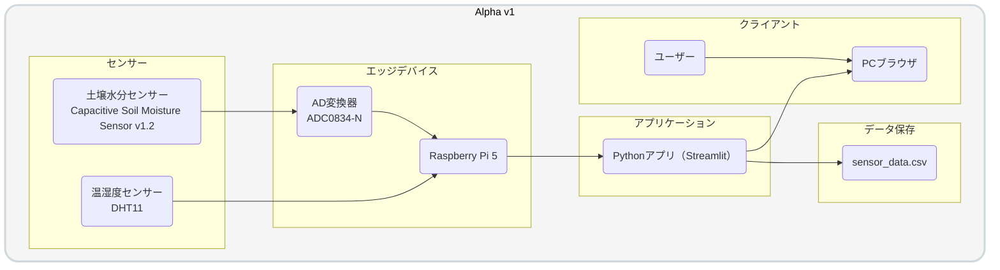

> 📂 **docs > alpha > v1 > architecture.md**

# システム構成（α版 v1）

ここでは、ObserLeaf（α版）のシステム構成と、各コンポーネントの役割・設計意図についてまとめています。

## 1. システム構成図

## 2. 各コンポーネントの役割

| コンポーネント | 役割 |
|---|---|
| DHT11 | 温度・湿度の測定 |
| 土壌水分センサー | 土壌水分量の測定 |
| ADC0834-N | 土壌水分センサーのアナログ値をデジタル値へ変換 |
| Raspberry Pi 5 | センサー値の取得・アプリケーションの実行 |
| Streamlit | センサーデータの表示・可視化 |
| sensor_data.csv | センサーデータの保存 |
| Webブラウザ | データの閲覧 |

## 3. 設計意図

### 3.1 Raspberry Piによるセンサー取得

Raspberry Pi 5がセンサー値の取得からデータの保存、Web画面の提供までを一括して担当する構成とした。

Raspberry Piをセンサー取得用のエッジデバイスとアプリケーション実行環境の両方として利用することで、システム全体をシンプルな構成で構築することを目的としている。

### 3.2 AD変換器によるアナログ値の取得

土壌水分センサーはアナログ出力であるため、Raspberry Piで値を取得するためにADC0834-Nを使用する。

Raspberry Piにはアナログ入力機能がないため、AD変換器を介してセンサーのアナログ値をデジタル値へ変換する構成とした。

### 3.3 Streamlitによる可視化

センサーデータの表示・可視化にはStreamlitを使用する。

Pythonを中心にセンサー取得処理とWeb画面を構築することで、センサーデータを取得してから可視化するまでの処理をシンプルに実装することを目的とした。

### 3.4 CSVによるデータ保存

センサーデータの保存にはCSVファイルを使用する。

α版では扱うデータ量やデータ構造が比較的単純であるため、導入が容易でPythonからも扱いやすいCSVを採用した。

### 3.5 シンプルな構成による試作

α版では、植物の環境情報を取得し、保存・可視化する基本的な機能を実現することを優先した。

そのため、センター・Raspberry Pi・Streamlit・CSVを中心としたシステム構成とし、システムの基本的な動作を検証できることを目的とした。