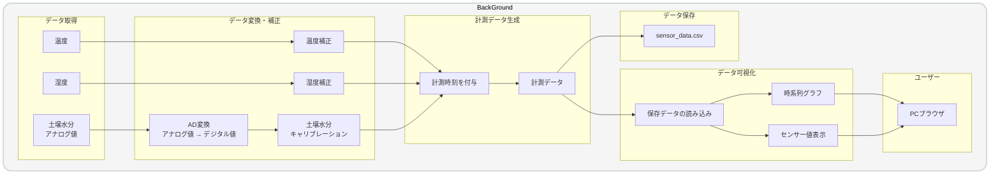

> 📂 **docs > alpha > v1 > data-flow.md**

# データフロー（α版 v1）

ここでは、ObserLeaf（α版 v1）におけるセンサーデータの取得から保存・可視化までのデータフローについてまとめています。

## 1. データフロー図

## 2. データフローの概要

ObserLeaf（α版 v1）では、センサーから取得した温度・湿度・土壌水分のデータを処理し、計測データとして保存・可視化する。

温度・湿度は補正を行い、土壌水分はAD変換およびキャリブレーションを行った後、計測時刻を組み合わせて1件のデータを生成する。

生成した計装データは `sensor_data.csv` に保存するとともに、Streamlit上で読み込み、時系列グラフやセンサー値として表示する。

## 3. データ項目

| データ項目 | 内容 | データ型 | 単位 |
| :---: | :---: | :---: | :---: |
| timestamp | 計測時刻 | datetime | - | 
| temperature_c | 温度 | float | ℃ |
| humidity_pct | 湿度 | float | % |
| soil_raw | 土壌水分 | float | % |

## 4. データ処理

### 4.1 温度・湿度の補正

DHT11から取得した温度・湿度に対して補正値を適用し、補正後の値を計測データとして使用する。

### 4.2 土壌水値の算出

土壌水分センサーから取得した値を、キャリブレーション値を用いて0～100%の土壌水分率に変換する。

$$
M = \frac{R-D}{W-D}\times100
$$

- $M$ : 土壌水分率（%）
- $R$ : ADCから取得したセンサー値（`raw_val`）
- $D$ : 乾燥状態の基準値（`DRY_VALUE`）
- $W$ : 湿潤状態の基準値（`WET_VALUE`）

算出した値は、以下の処理によって0～100%の範囲に制限する。

$$
M' = \max(0,\min(100,M))
$$

`DRY_VALUE` および `WET_VALUE` には、センサーのキャリブレーションによって設定した値を使用する。これらの値は測定環境や使用する土壌などに応じて調整する。

### 4.3 計測データの生成

補正・変換した各センサーデータに計測時刻を付与し、1件のデータとしてまとめる。