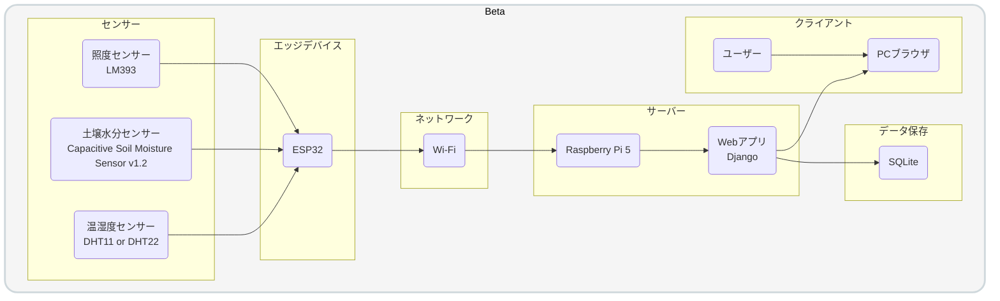

> 📂 **docs > beta > architecture.md**

# システム構成（β版）

ここでは、ObserLeaf（β版）のシステム構成と、各コンポーネントの役割・設計意図についてまとめています。

## 1. システム構成図

## 2. 各コンポーネントの役割

| コンポーネント | 役割 |
|---|---|
| ESP32 | センサー値の取得・データ送信 |
| DHT22 | 温度・湿度の測定 |
| 土壌水分センサー | 土壌水分量の測定 |
| LM393 | 照度の測定 |
| Wi-Fi | ESP32とRaspberry Pi間の通信 |
| Raspberry Pi 5 | Webサーバー・データ管理 |
| Django | API・Web画面・データ処理 |
| SQLite | センサーデータ及び各種データの保存 |
| Webブラウザ | データの閲覧 |

## 3. α版からの変更点

- センサー取得をRaspberry PiからESP32へ移行
- DHT11からDHT22へ変更
- 照度センサーを追加
- StreamlitからDjangoへ移行
- CSVからSQLiteへ移行
- Wi-Fiによるセンサーデータ送信を導入

## 4. 設計意図

### 4.1 ESP32によるセンサー取得

センサー値の取得をRaspberry PiからESP32へ移行した。

Raspberry PiはWebアプリケーションやデータ管理などの処理を担当し、ESP32はセンサー値の取得とサーバーへの送信を担当することで、それぞれの役割を分離することを目的としている。

また、役割を分離することでESP32を複数台運用できる構成とし、複数の植物を同時に観測できるシステムへの拡張を目的としている。

### 4.2 Wi-Fiによるデータ通信

ESP32とRaspberry Pi間の通信にはWi-Fiを使用する。

これにより、センサーを接続したESP32とRaspberry Piを物理的に
接続する必要がなくなり、センサー設置場所の自由度を高めることができる。

### 4.3 Raspberry Piをサーバーとして利用

Raspberry Pi 5上でDjangoを動作させ、
センサーデータの受信・処理・保存・Web画面の提供を行う。

既存のRaspberry Piを活用することで、専用サーバーを用意することなく
システム全体を構築できる。

### 4.4 SQLiteによるデータ管理

センサーデータの保存にはSQLiteを使用する。

α版ではCSVを使用していたが、β版では複数のセンサーデータや
植物・デバイスなどの情報を扱うため、データベースによる管理へ移行した。

### 4.5 DjangoによるWebアプリケーション

WebアプリケーションにはDjangoを採用した。

センサーデータをAPIで受信する機能と、保存したデータを
Webブラウザから閲覧する機能を一つのアプリケーションで管理することで、
システム全体の構成を整理しやすくすることを目的としている。