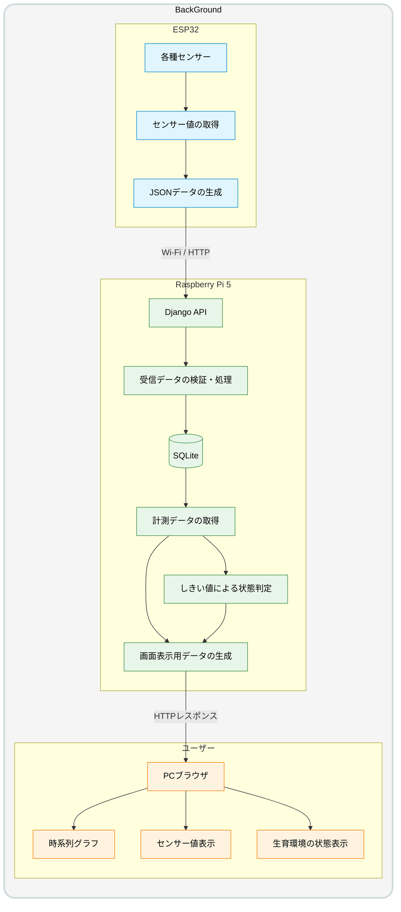

> 📂 **docs > beta > data-flow.md**

# データフロー（β版）

ここでは、ObserLeaf（β版）におけるセンサーデータの取得から保存・可視化までのデータフローについてまとめています。

## 1. データフロー図

## 2. データフローの概要

Obserleaf（β版）では、ESP32に接続した各センサーから温度・湿度・土壌水分・光のデータを取得し、JSON形式に変換してWi-Fi経由でRaspberry Pi 5上のDjango APIへ送信する。

Django APIでは受信データを検証・処理し、SQLiteデータベースに計測データとして保存する。

Web画面から計測データを取得する際は、Django側でデータを処理し、温度・湿度・土壌水分・光スコアの時系列グラフや数値の表示に必要な情報を返却する。また、設定されたしきい値に基づいて生育環境の状態を判定し、その結果をWeb画面に表示する。

## 3. データ項目

## 4. データ処理

### 4.1 センサー値の取得

ESP32に接続された温度・湿度センサー、土壌水分センサー、光センサーから計測値を取得する。

### 4.2 計測データの生成・送信

取得したセンサー値にデバイス名や計測時刻などの情報を組み合わせ、JSON形式の計測データを生成する。生成したデータはWi-Fiを利用し、HTTP通信によってRaspberry Pi 5上のDjango APIへ送信する。

### 4.3 受信データの処理・保存

Django APIで受信したデータの内容を検証し、必要な処理を行ったうえでSQLiteデータベースに保存する。計測時刻とサーバー受信時刻を区別して記録する。

### 4.4 計測データの取得・可視化

Web画面からDjangoを通じて計測データを取得し、温度・湿度・土壌水分・光スコアをそれぞれ時系列グラフや数値として表示する。

### 4.5 生育環境の状態判定

Django側で取得したセンサー値と植物に設定されたしきい値を比較し、生育環境の状態を判定する。判定結果はWeb画面に返却され、ユーザが植物の生育環境を把握するために使用される。