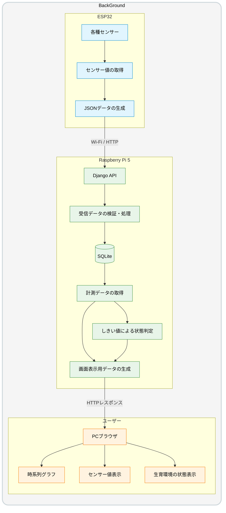

> 📂 **docs > beta > data-flow.md**

# データフロー（β版）

ここでは、ObserLeaf（β版）におけるセンサーデータの取得から保存・可視化までのデータフローについてまとめている。

## 1. データフロー図

## 2. データフローの概要

Obserleaf（β版）では、ESP32に接続した各センサーから温度・湿度・土壌水分・光のデータを取得し、JSON形式に変換してWi-Fi経由でRaspberry Pi 5上のDjango APIへ送信する。

Django APIでは受信データを検証・処理し、SQLiteデータベースに計測データとして保存する。

Web画面から計測データを取得する際は、Django側でデータを処理し、温度・湿度・土壌水分・光スコアの時系列グラフや数値の表示に必要な情報を返却する。また、設定されたしきい値に基づいて生育環境の状態を判定し、その結果をWeb画面に表示する。

## 3. データ項目

ここでは、Obserleaf（β版）で使用するAPIごとに、送受信されるデータ項目をまとめている。各APIの項目は、リクエストとレスポンスに分けて記載する。

### 3.1 計測データ受信API

| 項目 | 内容 |
|---|---|
| メソッド / エンドポイント | POST /api/receive/ |
| 送信元 → 送信先 | ESP32 → Raspberry Pi 5（Django） |
| タイミング | 起動時の初回計測、及び計測間隔ごとの計測時 |

#### リクエスト（JSON）

| 区分 | 項目名 | 内容 | データ型 | 単位・形式 |
|---|---|---|---|---|
| デバイス情報 | deviceName | デバイスの識別名 | string | 空でない文字列 |
| デバイス情報 | macAddress | ESP32のMACアドレス | string | xx:xx:xx:xx:xx:xx形式 |
| デバイス情報 | ipAddress | ESP32のIPアドレス | string | 有効なIPアドレス |
| デバイス情報 | firmwareVersion | ファームウェアのバージョン | string | 空でない文字列 |
| 計測情報 | timestamp | 計測時刻 | int | Unix時刻（秒）、正の整数 |
| 計測情報 | dhtEnabled | 温湿度センサーの有効状態 | bool |
| 計測情報 | soilEnabled | 土壌水分センサーの有効状態 | bool |
| 計測情報 | lightEnabled | 光センサーの有効状態 | bool |
| 計測情報 | temperature | 温度 | float / null | ℃ |
| 計測情報 | humidity | 湿度 | float / null | % |
| 計測情報 | soilRaw | 土壌水分センサーの生データ | int / null | ADC値（0～4095） |
| 計測情報 | lightRaw | 光センサーの生データ | int / null | ADC値（0～4095） |

リクエストに関する制約は以下の通り
- 上記12項目は全て必須であり、値がない場合もキーを省略せずnullを設定する。
- センサーが無効な場合、または計測に失敗した場合は、そのセンサーの計測値をnullとする。
- temperatureとhumidityは、両方とも値を持つか、両方ともnullである必要がある。

#### リクエスト（JSON）

| 項目名 | 内容 | データ型 |
|---|---|---|
| status | 処理結果（成功時はsuccess） | string |
| next_interval | デバイスに設定された計測間隔（interval_secondsと同じ値） | int |

なお、ESP32は`next_interval`を受信してログに記録するが、計測間隔の決定には使用しない（「3.2 デバイス設定取得API」を参照）

検証エラーなどの場合は、HTTPスタータス400でstatus(error)とmessageが返される

### 3.2 デバイス設定取得API

ESP32が、Raspberry Pi 5で管理されているデバイス設定を取得するAPI

| 項目 | 内容 |
|---|---|
| メソッド / エンドポイント | GET /api/device_config/ |
| 送信元 → 送信先 | ESP32 → Raspberry Pi 5（Django） |
| タイミング | 起動時、および10秒ごとの設定確認時 |

#### リクエスト（クエリパラメータ）

| 項目名 | 内容 | データ型 | 形式 |
|---|---|---|---|
| macAddress | 設定を取得するデバイスのMACアドレス | string | xx:xx:xx:xx:xx:xx形式 |

#### レスポンス（JSON）

| 項目名 | 内容 | データ型 |
|---|---|---|
| config_version | 設定のバージョン | int（正の整数） |
| interval_seconds | 計測間隔 | int（正の整数、秒） |
| sensors | 各センサーの有効・無効設定 | object |
| sensors.dht | 温湿度センサーの有効状態 | bool |
| sensors.soil | 土壌水分センサーの有効状態 | bool |
| sensors.light | 光センサーの有効状態 | bool |

ESP32は取得した設定を検証し、`config_version`が現在の設定より新しい場合にのみ反映する。取得に失敗した場合や、バージョンが同じ・古い場合は、現在の設定を維持する。

デバイスが登録されていない場合はHTTPステータス404、パラメータが不正な場合は400で、status（error）とmessageが返される。

### 3.3 適用済み設定報告API

ESP32が、新しいデバイス設定を適用したことをRaspberry Pi 5へ報告するAPI

| 項目 | 内容 |
|---|---|
| メソッド / エンドポイント | POST /api/device_config/applied/ |
| 送信元 → 送信先 | ESP32 → Raspberry Pi 5（Django） |
| タイミング | デバイス設定の変更を適用したとき |

#### リクエスト（JSON）

| 項目名 | 内容 | データ型 |
|---|---|---|
| macAddress | 報告するデバイスのMACアドレス | string（xx:xx:xx:xx:xx:xx形式） |
| applied_config_version | 適用した設定のバージョン | int（正の整数） |

#### レスポンス（JSON）

| 項目名 | 内容 | データ型 |
|---|---|---|
| status | 処理結果（記録時は `recorded`） | string |
| applied_config_version | サーバーに記録された適用済みバージョン | int |
| config_version | サーバーが配布している最新の設定バージョン | int |
| up_to_date | 適用済みバージョンが最新と一致しているか | bool |

ESP32は、HTTPステータスが200で、かつ `up_to_date` が `true` の場合に報告成功とみなす

報告されたバージョンがサーバーの設定バージョンより新しい場合はHTTPステータス409、デバイスが登録されていない場合は404、リクエストが不正な場合は400となる

### 3.4 グラフデータ取得API

Webブラウザが、ダッシュボードのグラフ表示用データを取得するAPI

| 項目 | 内容 |
| --- | --- |
| メソッド / エンドポイント | GET `/api/chart-data/` |
| 送信元 → 送信先 | Raspberry Pi 5（Django） → PCブラウザ |
| タイミング | グラフ表示時 |

レスポンス（JSON）

| 項目名 | 内容 | データ型 |
| --- | --- | --- |
| labels | 計測時刻（時:分:秒）の配列 | string[] |
| temperature | 温度の配列 | (float / null)[] |
| humidity | 湿度の配列 | (float / null)[] |
| moisture | 土壌水分率の配列 | (float / null)[] |

対象は直近20件の計測データで、時刻の昇順に並べて返される。現時点では、光量（light）のデータはこのAPIには含めていない

### 3.5 受信後に保存されるデータ項目

計測データ受信API（3.1）で受信したデータは、Raspberry Pi 5側で以下のように処理・保存される。

#### SensorLogへの保存

| 保存項目 | 元データ | 処理内容 |
| --- | --- | --- |
| device | macAddress | デバイスを特定する。未登録の場合は、deviceNameとMACアドレスからデバイス名を生成して登録する |
| measured_at | timestamp | Unix時刻（秒）から日時へ変換する |
| received_at | （送信されない） | Raspberry Pi 5の受信日時を付与する |
| temperature | temperature | センサーが無効な場合は null とする |
| humidity | humidity | センサーが無効な場合は null とする |
| soil_raw | soilRaw | センサーが無効な場合は null とする |
| light_raw | lightRaw | センサーが無効な場合は null とする |
| moisture | soilRaw | 土壌水分率（%）へ変換する。乾燥時の値2550、湿潤時の値500を用い、0〜100の範囲に制限して小数第1位までとする。soilRaw が null の場合は変換せず null とする |
| light | lightRaw | 光量スコアへ変換する。暗い時の値4095、明るい時の値0を用い、0〜100の範囲に制限して小数第1位までとする。lightRaw が null の場合は変換せず null とする |

※moistureの下限上限値については、現在までの検証環境に基づいた値を設定している

#### Deviceへの反映

| 保存項目 | 元データ | 処理内容 |
| --- | --- | --- |
| ip_address | ipAddress | 受信のたびに最新の値へ更新する |
| firmware_version | firmwareVersion | 受信のたびに最新の値へ更新する |
| reported_dht_enabled | dhtEnabled | ESP32から報告されたセンサー有効状態を記録する |
| reported_soil_enabled | soilEnabled | 同上 |
| reported_light_enabled | lightEnabled | 同上 |
| last_seen_at | （送信されない） | SensorLogの保存後、受信日時（received_at）で更新する |

## 4. データ処理

### 4.1 センサー値の取得

ESP32に接続された温度・湿度センサー、土壌水分センサー、光センサーから計測値を取得する。

### 4.2 計測データの生成・送信

取得したセンサー値にデバイス名や計測時刻などの情報を組み合わせ、JSON形式の計測データを生成する。生成したデータはWi-Fiを利用し、HTTP通信によってRaspberry Pi 5上のDjango APIへ送信する。

計測時刻（`timestamp`）は、ESP32が起動時にNTPで同期した時刻に基づくUnix時刻（秒）である。

計測間隔は、ESP32がデバイス設定APIから取得する`interval_seconds`によって決まる。ESP32は10秒ごとに設定の変更を確認し、`config_version`が変わった場合にのみ新しい設定（計測間隔と各センサーの有効・無効）を反映する。なお、計測データ送信への応答に含まれる`next_interval`は、サーバ側ではデバイスの`interval_seconds`と同じ値を返しているが、ESP32はこれを受信してログに記録するのみで、計測間隔の決定には使用しない。

※時刻については、起動時にNTP同期を行う。一方、日付が変わった際の再同期を行う関数（`updateTimeSync()`）は定義されているが、現在のメインループからは呼び出されていない。

### 4.3 受信データの処理・保存

Django APIで受信したデータの内容を検証し、必要な処理を行ったうえでSQLiteデータベースに保存する。計測時刻とサーバー受信時刻を区別して記録する。

### 4.4 計測データの取得・可視化

Web画面からDjangoを通じて計測データを取得し、温度・湿度・土壌水分・光スコアをそれぞれ時系列グラフや数値として表示する。

### 4.5 生育環境の状態判定

Django側で取得したセンサー値と植物に設定されたしきい値を比較し、生育環境の状態を判定する。判定結果はWeb画面に返却され、ユーザが植物の生育環境を把握するために使用される。