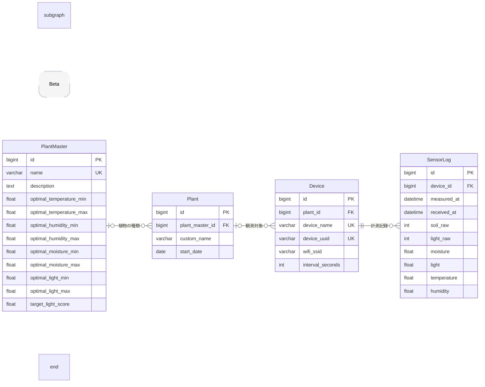

> 📂 **docs > beta > er-diagram.md**

# ER図（β版）

ここでは、ObserLeaf（β版）のDjangoモデルと、各モデルの役割・リレーション・設計意図についてまとめています。

## 1. ER図

## 2. 各モデルの役割

| モデル | 役割 |
|---|---|
| PlantMaster | 植物の種類、説明、適切な生育環境の基準値を管理する。 |
| Plant | ユーザーが実際に育成している植物を管理する。 |
| Device | ESP32などのデバイス識別情報や計測間隔などの設定を管理する。 |
| SensorLog | デバイスから取得した環境データと計測日時・受信日時を記録する。 |

## 3. リレーション

| リレーション | 関係 |
|---|---|
| PlantMaster - Plant | 1つの植物マスタに対して、複数の育成植物を関連付けられる。 |
| Plant - Device | 1つの育成植物に対して、複数のデバイスを関連付けられる。 |
| Device - SensorLog | 1つのデバイスに対して、複数の計測ログを記録できる。 |

PlantMasterとPlant、PlantとDeviceの関連付けは任意であり、関連先が設定されていないデータも扱える。一方、SensorLogには必ずDeviceが関連付けられる。

## 4. 設計意図

### 4.1 植物マスタと育成植物の分離

植物の種類に関する情報と、ユーザーが実際に育てている植物の情報を分離した。

PlantMasterでは植物の基本情報や適正な生育環境を管理し、Plantでは個々の育成植物の名前や栽培開始日を管理する。

これにより、植物の種類に関する共通情報と、個々の栽培対象に関する情報を分けて管理できる。

### 4.2 デバイスと育成植物の関連付け

DeviceをPlantに関連付けることで、土のデバイスがどの植物を観測するのかを管理できる構成とした。

また、関連付けを任意とすることで、観測対象が未設定のデバイスも登録できる。

### 4.3 デバイス単位での計測ログ管理

SensorLogはPlantではなくDeviceに関連付けている。

これにより、計測データの取得元を明確にし、デバイスごとの計測履歴を管理できる。また、Deviceを介して観測対象のPlantを特定できる。

### 4.4 計測日時と受信日時の分離

計測データには、ESP32で計測した日時と、Raspberry Piで受信した日時をそれぞれ記録する。

これにより、計測日時とサーバーへの到着時刻を区分し、通信による遅延などを確認できる構成とした。